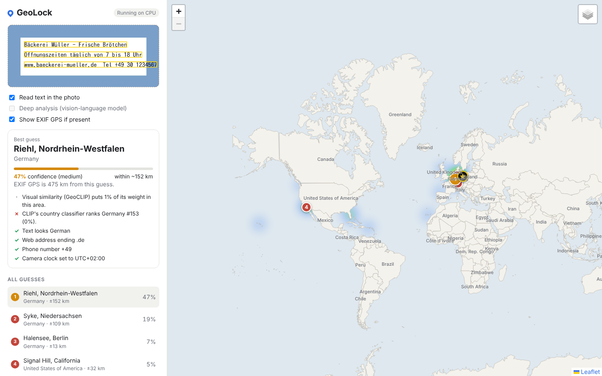

# GeoLock

Drop in a photo; GeoLock tells you where on Earth it was most likely taken, how sure it
is, and why. It runs entirely on your laptop with OpenVINO (Intel Arc GPU, NPU or CPU).
No cloud, no API keys, no subscriptions. Optionally, it can also ask Claude or ChatGPT
for a second opinion using the plan you already pay for (see below).



<sub>UI preview from a test sign, rendered with placeholder model weights, so the visual-similarity numbers in it are meaningless; the text clues are real.</sub>

## Install (Windows desktop app)

1. Download `GeoLock_<version>_x64-setup.exe` from the repository's Releases page (or the
   `GeoLock-installer` artifact of the "Desktop app" workflow) and run it. No admin rights
   needed; GeoLock appears in the Start menu.
2. On first launch, click **Download and set up**: it fetches the CLIP model once
   (609 MB) and prepares it for your processor. If you already have a GeoLock `models`
   folder, choose **Use models from an existing GeoLock folder** instead.
3. Drop photos anywhere in the window, paste with Ctrl+V, or press Ctrl+O.

How the app is put together: [desktop/README.md](desktop/README.md) and
[desktop/API.md](desktop/API.md).

## Quick start from source (Windows)

1. Install [Python 3.12](https://www.python.org/downloads/) (tick "Add python.exe to PATH").
2. Open PowerShell in this folder and run:

   ```powershell
   Set-ExecutionPolicy -Scope Process Bypass
   .\setup.ps1          # one time: ~2.5 GB download, 5-10 minutes
   ```

   Options: `-Int8` for smaller, faster CLIP weights; `-Vlm` to also install the
   optional deep-analysis model (another ~6 GB, see below).
3. Double-click `run.bat` (or `.venv\Scripts\python -m geolock`). The app opens at
   <http://127.0.0.1:7860>. Drag a photo onto it, or paste one with Ctrl+V.

After setup, nothing needs the internet. The "OpenStreetMap" map layer (top right of
the map) is the only optional online feature; the default offline map is built in.

Linux/macOS: `./setup.sh` then `.venv/bin/python -m geolock`.

## What it shows

- **Up to five guesses** on the map, numbered and coloured by confidence, each with a
  circle for its likely radius and the nearest named place.
- **Confidence** for each guess: the share of the model's probability that falls within
  ~250 km of it. High ≥ 50 %, medium ≥ 20 %, low below that.
- **Country odds**, with CLIP's opinion alone on hover.
- **Clues**: text read in the photo (Latin, Cyrillic, Greek, Chinese, Japanese, Korean,
  Thai, Arabic, Devanagari, Tamil, Telugu) and its language, web domains, phone prefixes,
  currency signs, mph signs, writing system, architecture and road-marking hints, EXIF
  time zone, and with deep analysis the model's own observations (driving side, plates,
  bollards, vegetation and so on). Each guess lists which clues back it (✓) or argue
  against it (✗).
- A **heatmap** of everywhere the model considered, and the photo's own **EXIF GPS**
  (★) when present so you can check the answer.

## Second opinion from Claude or ChatGPT (optional)

Tick **Ask Claude** or **Ask ChatGPT** before dropping a photo. GeoLock first does its own
analysis, then sends the photo and a short summary of what it found to the model, and
shows the model's reasoning, its guesses (◆ C / ◆ G on the map) and what it saw. Its
answer is blended into the ranked guesses (75 % weight by default, honouring the model's
own confidence). Untick **Share GeoLock's findings** for a fully independent opinion.

It uses your own login through the official command-line tools, so it counts against
your plan's usage, not an API bill:

- Claude (Pro or Max): install [Claude Code](https://code.claude.com/docs/en/setup), then
  run `claude auth login` once.
- ChatGPT (Plus, Pro, Business…): `npm i -g @openai/codex`, then `codex login` once.

`geolock analysts` says which are ready. The boxes are greyed out (hover for why) until
then. Only the photo's pixels are sent: its metadata, including GPS, stays on your
computer. Each answer takes about 5-60 seconds. API keys also work if you prefer
(`ANTHROPIC_API_KEY` with `pip install anthropic`, or `codex login --with-api-key`), but
those are billed per use.

## Command line

```bash
geolock locate photo.jpg [--json] [--vlm]   # print guesses
geolock locate photo.jpg --ask claude --ask chatgpt   # plus second opinions
geolock analysts                            # is Claude / ChatGPT usable from here?
geolock eval ~/Pictures/trips --fit         # accuracy on your own geotagged photos,
                                            # and tune confidence to match them
geolock testset data/testset                # download ~300 openly licensed geotagged
geolock eval data/testset --fit             # photos from around the world, then test
geolock bench                               # model speed on this machine
geolock --device NPU serve                  # pick a device (AUTO, GPU, NPU, CPU)
```

`geolock eval` hides each photo's EXIF GPS from the model, predicts, and reports how
often it lands within 1 / 25 / 200 / 750 / 2500 km and whether the confidence levels are
honest. It is the best way to see how well GeoLock does on the kind of photos you take.
With `--fit` (20+ photos) it also tunes the fusion so the confidence numbers match how
often it is actually right, and the app uses those settings from then on.

No geotagged photos of your own? `geolock testset <folder>` downloads a world-spread set
from Wikimedia Commons (random towns in every country, maps and scans skipped), with a
`labels.csv` of true locations and an `ATTRIBUTION.md` of each photo's author and licence.
`geolock eval` uses `labels.csv` when a folder has one. Re-running `testset` tops the
folder up. `tools/build_inat_testset.py` builds a similar set from iNaturalist's open data
when Commons is out of reach.

HEIC photos from iPhones work too.

## How it works

See [info.md](info.md) for the full design, model choices and status.

## Licences

GeoLock's code is MIT. Models and data have their own (all free and open); see
[THIRD_PARTY.md](THIRD_PARTY.md).
